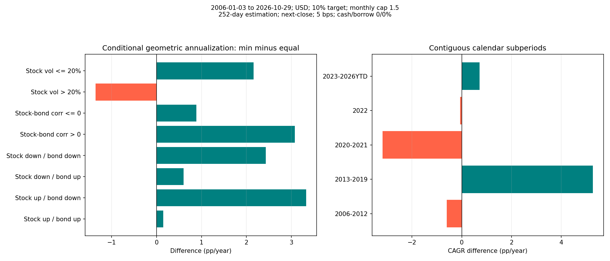
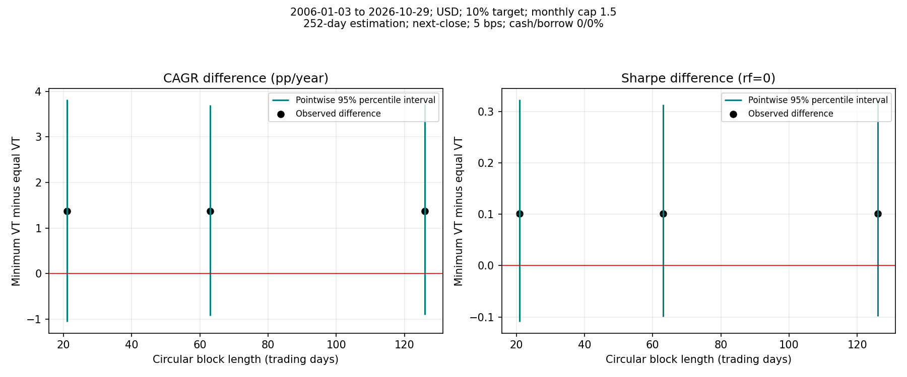

Quantitative Portfolio Research

[](https://github.com/shotafujii0925-sys/Quantitative-Portfolio-Research/actions/workflows/research-checks.yml)

金融工学の数式・Python実装・検証を対応させる個人研究プロジェクトです。
SPY・TLT・GLDを対象に、過去のリスク特性を使う資産配分とボラティリティ・ターゲティング（VT）を比較します。
インターン準備を契機に取り組みました。

## 研究の問いと主要結果

**最小分散＋VTは、等ウェイト＋VTを市場環境によらず上回るか？**

2006-01-03〜2026-10-29の同じ価格観測版、252日推定、月次判断・翌営業日終値約定、
片道5bps、年率目標ボラ10%、月次目標倍率上限1.5倍、預金・借入金利0%で比較しました。

|指標|等ウェイト＋VT|最小分散＋VT|
|---|---:|---:|
|CAGR|9.08%|10.46%|
|実現年率ボラ|10.69%|10.89%|
|Sharpe（rf=0）|0.867|0.968|
|最大ドローダウン|−24.16%|−25.39%|

- 全期間のCAGR差は最小分散が**＋1.37ポイント**。
- 63日ペア循環ブロック・ブートストラップ10,000回の95%区間は**−0.92〜＋3.70ポイント**。
  21日・126日ブロックでも0を跨ぎ、統計的優位性を確認できませんでした。
- 2006〜2012年、2020〜2021年等では優劣が逆転。年別CAGRでは21年中13年で最小分散が上回りました
  （2026年は10月29日まで）。
- 前日情報による株式高ボラ局面でも逆転が観測されました。局面依存そのものの統計的確定や、
  将来にも成立する普遍的優位性を示す結果ではありません。

**過去全期間の点推定で上回ったことと、戦略の有効性が証明されたことは区別します。**
実現ボラは一致しておらず、配分選択・研究の事後性・データ制約も残ります。





## 読む順序

|研究・教材|入口|
|---|---|
|主要な検証結果と限界|[市場環境に依存しない優位性の検証](outputs/reports/市場環境に依存しない優位性の検証.md)|
|VT、金利、レバレッジ、推定窓の比較|[リスク統一比較レポート](outputs/reports/リスク統一比較_分析レポート.md)|
|配分・倍率・調達費用の分解|[収益要因分解レポート](outputs/reports/戦略比較と収益分解_分析レポート.md)|
|数学・実装の学習|[Notebookと実装案内](資料/07_研究コードと成果物の案内.md)|
|公開範囲と検証|[公開前監査と検証](資料/公開前監査と検証.md)|

Notebookは日本語の目的・理論・データ・条件・実装・可視化・解釈・限界の順に説明します。
原本のコードは表示したまま、出力は除去して公開しています。GitHubではコードと説明を読めます。
実行結果と全図は各自の環境で再生成してください。選定した独自分析図と集計レポートは公開済みです。

## 研究の範囲

- SPY（米国株式）、TLT（米国長期国債）、GLD（金）の時系列分析。
- CAPM、平均分散最適化、効率的フロンティア、基礎ファクターモデル。
- 等ウェイト・逆ボラ・最小分散の過去情報だけを使った月次比較。
- 目標ボラ8/10/12%、倍率無上限/1.5倍、126/252/504日推定の感応度。
- キャッシュ・借入、取引費用、調達金利、実際の売買額を追う自己資金台帳。
- CAGR差の比較経路、日次損益恒等式、年率対数差、実支払額を区別した収益分解。
- ペアブロック再標本化、ローリング、暦期間、前日情報での市場局面分析。
- 線形/Ridge/Lasso/Random Forest/LightGBMとMicrosoft Qlibの学習環境。

01〜05の教材とQlibデモは**合成データ**です。実市場での予測能力を実証したものではありません。
06〜10は実価格研究、またはデータ種別を明示した案内です。

## データと再現性の範囲

出典はYahoo Finance、取得クライアントはyfinance 0.2.66、USD・調整終値です。
入力価格は2004-11-18〜2026-10-29、研究の取得版は2026-10-31 UTCです。
原価格・日次系列・Qlibデータ・出力付きNotebookは配布しません。
[データ方針・取得版の記録](DATA_POLICY.md)を先に確認してください。

調整価格は後日改訂され得ます。別PCで同じコード・依存版を再現しても、再取得データから
公表値と完全に同じ数値が出るとは限りません。元データを同梱しないためビット単位の再現はできません。

## セットアップ

必要：Git、uv 0.10.10、Python 3.11.14、VS Code（任意）。Windowsを主環境とし、Linux用CIも設定しています。
Dockerは日常分析の必須条件ではありません。数GBの空き容量と依存取得用のネット接続を用意します。

```bash
git clone https://github.com/shotafujii0925-sys/Quantitative-Portfolio-Research.git
cd Quantitative-Portfolio-Research
uv python install 3.11.14
uv sync --locked --group dev
uv run --no-sync python -m ipykernel install --prefix .venv --name quant-ai --display-name "Python (quant-ai)"
```

WindowsでPython本体とuvキャッシュもこのフォルダ内へ置く場合は、PowerShellで
`powershell -File scripts/setup.ps1`を実行できます。既存の環境がある場合は再構築不要です。

VS Codeでこのフォルダを開き、`Python: Select Interpreter`からプロジェクトの`.venv`を選び、
Notebook右上で同じ環境または`quant-ai`カーネルを指定します。Notebook原本は`学習ノート/`です。

### 市場データなしで教材を実行

```bash
uv run --no-sync python scripts/execute_notebooks.py "01_CAPMと市場リスク.ipynb" "02_平均分散とポートフォリオ最適化.ipynb" "03_ファクターモデル.ipynb" "04_機械学習と運用評価.ipynb" "05_Qlibによるクオンツ分析.ipynb"
uv run --no-sync python scripts/run_qlib.py
```

### 実データ研究を再計算

自身の用途でデータを利用できることを確認した後、以下の順で実行します。
取得の既定末日2026-10-30は排他的で、評価を10月29日までにそろえます。
既存価格の上書きは明示的な`--overwrite`が必要です。

```bash
uv run --no-sync python scripts/fetch_allocation_data.py
uv run --no-sync python scripts/run_allocation_study.py
uv run --no-sync python scripts/run_risk_normalized_study.py
uv run --no-sync python scripts/check_risk_research.py
uv run --no-sync python scripts/run_return_attribution.py
uv run --no-sync python scripts/check_market_independence.py
uv run --no-sync python scripts/execute_notebooks.py
```

実データ研究は前段の生成物を次段が使います。数分以上かかる場合があります。
01〜05は外部市場データ不要、06〜10は上記のローカル生成物を必要とします。
新たな取得版による差を元版の成績改善と混同せず、出典・取得日時・ハッシュを記録します。

## 実装上の検証方針

- 判断は終値t、約定はt+1終値、新保有の最初の損益はt+1からt+2への変化。
- 共分散・特徴量は予測時点まで。未来価格を書き換えて過去の特徴・配分・損益が変わらないかテスト。
- MLは時間順分割、教師の終点に応じたpurge、学習内だけの前処理を実施。
- 売買コストは各資産の実売買金額、利息はACT/365、初回取得費用も計上。
- CAGRは幾何年率、Sharpeは日次算術平均から計算。レバレッジ後のCAGR/DDを単純比例させない。
- VTの目標倍率上限と月中実現倍率を区別。マージンコール・日次強制縮小は未実装。
- 過去情報のみの売買ルールでも、既知の結果を参照した研究選択は独立したOOSではない。
- ブートストラップは既に得た経路に条件付き。重み再推定、構造変化、未記録のモデル選択を全て含まない。

```bash
uv run --no-sync pytest -q
uv run --no-sync ruff check src tests scripts
uv run --no-sync ruff format --check src tests scripts
uv run --no-sync python scripts/audit_publication.py --history
```

GitHub ActionsではロックからのLinux新規導入、pytest、Ruff、公開ファイル・履歴監査、
合成教材01〜05の実行を行います。市場データをダウンロードするCIではありません。
ローカルとCIの実施範囲・警告・未確認事項は[検証記録](資料/公開前監査と検証.md)に分けます。

## 主要ライブラリ

|用途|固定バージョン|
|---|---|
|Python / uv|3.11.14 / 0.10.10|
|NumPy / pandas / SciPy|1.26.4 / 2.2.3 / 1.15.3|
|statsmodels|0.14.5|
|yfinance / PyArrow|0.2.66 / 20.0.0|
|Matplotlib / seaborn / Plotly|3.10.7 / 0.13.2 / 6.3.1|
|scikit-learn / LightGBM|1.7.2 / 4.6.0|
|pyqlib / MLflow|0.9.7 / 3.1.0|
|JupyterLab / ipykernel|4.4.10 / 6.30.1|
|pytest / Ruff / nbclient|8.4.2 / 0.14.3 / 0.10.2|

直接依存と推移依存は`pyproject.toml`・`uv.lock`で管理します。
Qlibの初期化・式評価・DatasetH・LightGBM・公式バックテストは合成データで検証します。
PyTorch CPU版2.7.1+cpuは任意extraです。通常の木モデルに不要で、この研究では未インストール・未検証です。
大規模Qlibデータや深層学習の実証検証は未実施です。

## ディレクトリ

```text
src/quant_ai/       共通の分析・最適化・ML・バックテスト・統計評価
学習ノート/         出力なし日本語Notebook 01〜10
資料/               条件・定義・実装案内・検証記録
scripts/            取得、分析、環境確認、Notebook実行、公開監査
tests/              数理、時点、費用、リーケージ、Qlib統合テスト
outputs/reports/    選定した公開用の集計レポート、その他はローカルのみ
outputs/figures/    選定した公開用のポートフォリオ比較図、その他はローカルのみ
data/               ローカル取得・加工データ（非公開）
分析結果/           実行済みNotebook・実験ログ等（非公開）
.devcontainer/      任意のDocker / Dev Containers設定
.github/workflows/  データ取得を伴わないCI
```

## Docker / Dev Containers（任意）

```bash
docker build -t quant-ai:local -f .devcontainer/Dockerfile .
docker run --rm quant-ai:local python -m pytest -q
```

Dev Containersは`Dev Containers: Reopen in Container`から利用します。
コンテナのPython環境は`/opt/venv`、Windows側は`.venv`で分離します。
設定を用意しましたが、公開前のローカル監査環境ではDocker CLIが見つからず、実ビルドは未確認です。
OSパッケージやCPU差まで完全固定した環境ではありません。

## 生成AIの利用と研究上の責任

利用者が研究目的・仮説・評価観点を提示し、OpenAI Codex等の生成AIを使って、
実装、テスト、可視化、文書化、妥当性確認、結果解釈の文章作成を支援しています。
仮説設定・結果の採否・解釈の判断と、AIによる実装支援・提案を区別します。
AI生成コード・文章を検証なしに正しいとはみなしません。検証ログ、数式との照合、
合成データによる既知解、実データ上の整合性確認を通じて根拠を残します。
全実装を人手で独立に検証済みという意味ではありません。

## 公開・ライセンスと今後の研究

APIキー、個人ホームの絶対パス、実行ログ、元価格を公開対象から除外しています。
[データ方針](DATA_POLICY.md)、[ライセンス選定保留の方針](LICENSE_POLICY.md)、
[第三者依存](THIRD_PARTY.md)を参照してください。包括的OSSライセンスは未付与です。

追加研究はブランチを作り、仮説・指標・対象期間を先に記録し、`src/quant_ai/`の共通処理と
`tests/`を更新します。Notebook原本を編集し、実行済み版はローカルで生成します。
pytest・Ruff・公開監査後にコミットし、PRのCIと数値差を確認します。
独立将来の固定ルール検証、共分散の縮小推定、別市場、実調達条件・税・流動性・強制縮小が今後の課題です。
