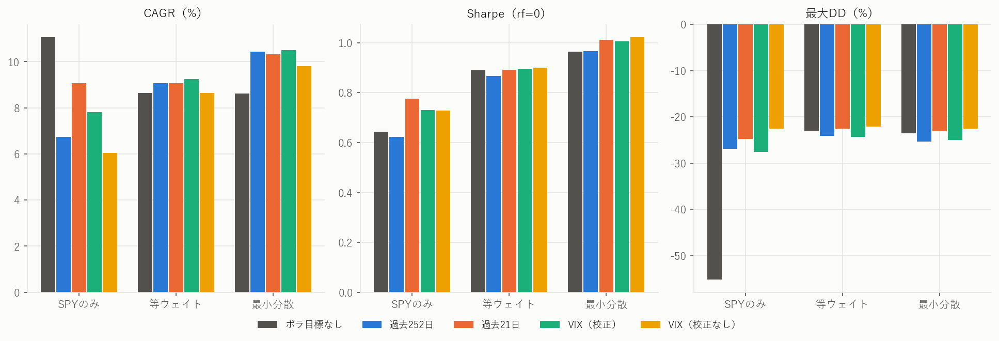
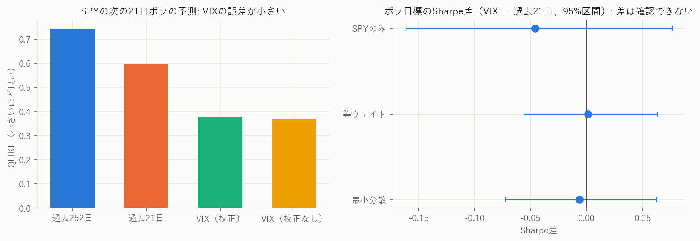
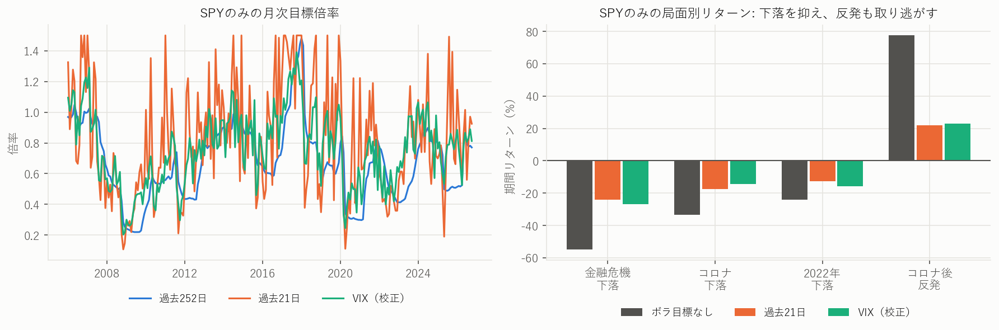

# VIXはボラ目標の成績を改善するか

2006-01-03〜2026-10-29（5,239営業日）。SPY・TLT・GLD、USD。価格は既存研究の取得版ではなく2026-11-07に再取得した版です。

> 本文の統計値はすべて `scripts/build_vix_report.py` が集計から差し込んでいます。実装と本文の作成にはAI（Claude）を使用しました。過去のバックテストであり、将来の成績や投資の推奨を示すものではありません。

## 結論

**VIXはSPYの将来ボラをよく予測しますが、ボラ目標の成績では過去21日の実現ボラと区別できませんでした。** 事前に決めた判定条件は満たしていません。

- **予測精度:** QLIKEはVIX（校正）0.378 に対し過去21日 0.597 で、差 -0.219 [-0.377, -0.076] は0を除外します。
- **運用成績:** VIXと過去21日のSharpe差は、3つの基本配分のすべてで区間が0を含み、Holm補正後のpは1.000です。
- **SharpeとCAGRの両立:** 最小分散でVIXを配分にも使う版は、金利0%の点推定ではSPY買い持ちをCAGR（11.30% 対 11.06%）とSharpe（1.052 対 0.644）の両方で上回ります。ただしCAGR差の区間は0を含み、金利を入れるか借入をなくすとCAGRはSPYを下回ります。
- **確かに言える効果:** SPYのみでは、ボラ目標は最大DDを -55.2% から -27.6% に縮めます。代償はCAGRの低下（7.82%）で、コロナ後の反発の大半も取り逃がします。

## 既存研究との一致の確認

`hist252` は既存のボラ目標と同じ計算です（テストで一致を確認）。再取得した価格でも、既存の公表値に近い結果になりました。

| 戦略 | 公表値（CAGR / ボラ / Sharpe / 最大DD） | 今回 |
|---|---|---|
| 等ウェイト＋VT | 9.08% / 10.69% / 0.867 / -24.16% | 9.08% / 10.69% / 0.867 / -24.16% |
| 最小分散＋VT | 10.46% / 10.89% / 0.968 / -25.39% | 10.44% / 10.89% / 0.967 / -25.39% |

差は調整済み価格の改訂によるものと考えられます。ただし原因は特定していません。

## 条件

条件と判定基準は [研究計画](../../資料/VIXボラ目標_研究計画.md) に記録しています。

- 月次判断、翌営業日終値で約定、片道5bps、目標ボラ10%、月次目標倍率の上限1.5倍、預金・借入金利0%
- SPYのボラ予測だけを置き換え、TLT・GLDのボラと相関は過去252日で推定
- VIX（校正）は VIX × exp(k)。kは判断日までに結果が確定した日の log(実現ボラ / VIX) の平均

## 全条件の成績

|基本配分|SPYのボラ予測|CAGR|実現ボラ|Sharpe|最大DD|ボラ10%換算CAGR|平均倍率|年率回転率|
|---|---|---|---|---|---|---|---|---|
|SPYのみ|ボラ目標なし|11.06%|19.17%|0.644|-55.19%|6.11%|1.00|0.05|
|SPYのみ|過去252日|6.74%|11.58%|0.622|-26.90%|5.88%|0.68|0.47|
|SPYのみ|過去21日|9.08%|12.15%|0.776|-24.75%|7.53%|0.82|3.21|
|SPYのみ|VIX（校正）|7.82%|11.18%|0.730|-27.61%|7.04%|0.76|1.43|
|SPYのみ|VIX（校正なし）|6.04%|8.55%|0.729|-22.56%|7.02%|0.58|1.07|
|等ウェイト|ボラ目標なし|8.65%|9.88%|0.889|-22.96%|8.76%|1.00|0.39|
|等ウェイト|過去252日|9.08%|10.69%|0.867|-24.16%|8.51%|1.12|0.66|
|等ウェイト|過去21日|9.07%|10.33%|0.892|-22.52%|8.79%|1.12|1.27|
|等ウェイト|VIX（校正）|9.25%|10.52%|0.894|-24.28%|8.80%|1.14|0.86|
|等ウェイト|VIX（校正なし）|8.65%|9.73%|0.901|-22.07%|8.88%|1.07|1.01|
|最小分散|ボラ目標なし|8.62%|8.99%|0.965|-23.55%|9.58%|1.00|0.73|
|最小分散|過去252日|10.44%|10.89%|0.967|-25.39%|9.60%|1.25|1.04|
|最小分散|過去21日|10.33%|10.23%|1.013|-23.02%|10.10%|1.23|1.57|
|最小分散|VIX（校正）|10.49%|10.47%|1.006|-25.06%|10.03%|1.26|1.27|
|最小分散|VIX（校正なし）|9.81%|9.61%|1.022|-22.54%|10.21%|1.18|1.48|
|最小分散|VIX（校正、配分も変更）|11.30%|10.73%|1.052|-26.73%|10.53%|1.29|2.12|

ボラ10%換算CAGRは事後のスケーリングによる記述的な値で、取引可能な戦略ではありません。



## 主要な比較: VIX − 過去21日

63日ペア循環ブロック・ブートストラップ（10,000回）です。21日と126日のブロックでも、すべて区間は0を含みました。

|基本配分|Sharpe（VIX）|Sharpe（過去21日）|差|95%区間|両側p|Holm p|
|---|---|---|---|---|---|---|
|SPYのみ|0.730|0.776|-0.046|[-0.161, +0.076]|0.465|1.000|
|等ウェイト|0.894|0.892|+0.001|[-0.056, +0.063]|0.970|1.000|
|最小分散|1.006|1.013|-0.006|[-0.072, +0.062]|0.823|1.000|

**判定:** Holm補正後に有意な基本配分がないので、計画の条件1を満たしません。したがって「VIXには過去21日の実現ボラを超える価値がある」とは判定しません。区間の幅を考えると、「差がない」と証明したわけでもありません。

## 予測精度

SPYの次の21日の実現ボラに対する、月末ごとの予測（250か月）です。

|予測|QLIKE|log誤差の2乗平均|logバイアス|log R²|
|---|---|---|---|---|
|過去252日|0.743|0.288|+0.166|0.167|
|過去21日|0.597|0.218|+0.002|0.355|
|VIX（校正）|0.378|0.149|+0.039|0.459|
|VIX（校正なし）|0.370|0.237|+0.302|0.466|

QLIKE差（12か月ブロック）は、VIX（校正）− 過去21日が -0.219 [-0.377, -0.076]、p=0.002 です。VIX（校正）− 過去252日は -0.365 [-0.715, -0.134] です。

校正なしのVIXはQLIKEが最小ですが、QLIKEは過小予測を重く罰する指標です。logバイアスは +0.302 と大きく、log誤差の2乗平均では校正版より劣るので、実現ボラを高めに見積もっています。そのため倍率が下がり、実現ボラも 8.55%（SPYのみ）と目標を下回ります。



予測が良くても成績に結びつかなかった理由は、この研究では特定していません。考えられるのは、ボラ目標の成績がボラ予測の精度だけでなく、倍率とその後のリターンの関係にも左右されること、月次判断では短期のボラ予測の利点が薄れること、過去21日でも主な変動を捉えていることです。週次判断でも結論は変わりませんでした。

## VIXのプラセボ

VIXを循環シフトし、市場との対応だけを壊した場合との比較です。

|基本配分|実績Sharpe|プラセボ中央値|片側p|シフト数|
|---|---|---|---|---|
|SPYのみ|0.730|0.559|0.025|239|
|等ウェイト|0.894|0.876|0.188|239|
|最小分散|1.006|0.946|0.013|239|

SPYのみと最小分散では、VIXは時期をずらした系列より良い結果でした（補正なし）。VIXに情報がないわけではなく、過去21日の実現ボラと比べた上乗せが確認できないという結果です。

## SharpeとCAGRの両立

差の95%区間です（63日ブロック、補正なしの参考値）。SPY買い持ちとの比較は、最初の結果を見た後に追加しました。

|比較|CAGR差（pt）|Sharpe差|最大DD差（pt、正が改善）|
|---|---|---|---|
|SPYのみ: VIX − 目標なし|[-7.12, +0.75]|[-0.107, +0.263]|[+5.3, +32.9]|
|最小分散: VIX − 目標なし|[+0.61, +3.23]|[-0.056, +0.140]|[-6.1, +2.3]|
|最小分散・過去21日 − SPY買い持ち|[-7.72, +6.25]|[-0.095, +0.794]|[+5.3, +42.1]|
|最小分散・VIX − SPY買い持ち|[-7.59, +6.47]|[-0.104, +0.786]|[+4.1, +40.5]|
|最小分散・VIX配分 − SPY買い持ち|[-6.69, +7.44]|[-0.052, +0.826]|[+3.8, +40.5]|
|最小分散: VIX配分 − VIX倍率のみ|[-0.38, +2.05]|[-0.055, +0.142]|[-3.7, +3.3]|

配分もVIXで変える版の条件別の成績です。

|条件|CAGR|実現ボラ|Sharpe|最大DD|
|---|---|---|---|---|
|SPY買い持ち（比較対象）|11.06%|19.17%|0.644|-55.19%|
|金利0%|11.30%|10.73%|1.052|-26.73%|
|金利2%/3%|10.33%|10.73%|0.970|-26.88%|
|金利4%/6%|9.40%|10.74%|0.890|-27.02%|
|倍率上限1倍（借入なし）|8.94%|8.62%|1.036|-24.36%|

金利0%で両方の点推定が上回るのは、平均 1.29 倍の倍率を無料で持てる前提によるところが大きいです。金利シナリオは期間全体で固定した仮定で、実際の金利の推移ではありません。また、この版は複数の候補のうち最も高かった点推定であり、選択の影響を含みます。SPY買い持ちとの差のうち、区間で確認できたのは最大DDの改善です（CAGR差 [-6.69, +7.44] pt、Sharpe差 [-0.052, +0.826]、最大DD差 [+3.8, +40.5] pt）。

## ショック前の倍率と局面別の損益

各下落の直前の判断日の目標倍率です。その日のVIXはそれぞれ 18.0、18.8、17.2 でした。

|基本配分|予測|金融危機の下落|コロナの下落|2022年の株債同時下落|
|---|---|---|---|---|
|SPYのみ|過去252日|0.78|0.84|0.77|
|SPYのみ|過去21日|0.69|0.82|0.60|
|SPYのみ|VIX（校正）|0.72|0.70|0.78|
|等ウェイト|過去252日|1.27|1.50|1.19|
|等ウェイト|過去21日|1.22|1.50|1.09|
|等ウェイト|VIX（校正）|1.23|1.49|1.19|
|最小分散|過去252日|1.50|1.50|1.21|
|最小分散|過去21日|1.50|1.50|1.07|
|最小分散|VIX（校正）|1.50|1.50|1.22|

局面は結果の分類だけに使っており、売買の判断には使っていません。

|基本配分|予測|金融危機の下落|金融危機後の反発|コロナの下落|コロナ後の反発|2022年の株債同時下落|
|---|---|---|---|---|---|---|
|SPYのみ|ボラ目標なし|-54.8%|71.9%|-33.4%|77.5%|-24.1%|
|SPYのみ|過去252日|-26.4%|14.7%|-25.8%|25.0%|-15.1%|
|SPYのみ|過去21日|-24.1%|22.2%|-17.3%|22.0%|-12.7%|
|SPYのみ|VIX（校正）|-26.8%|21.2%|-14.4%|23.0%|-15.9%|
|等ウェイト|ボラ目標なし|-8.2%|24.7%|-8.3%|18.4%|-21.4%|
|等ウェイト|過去252日|-7.3%|13.8%|-12.3%|18.5%|-22.9%|
|等ウェイト|過去21日|-7.9%|17.6%|-10.3%|12.0%|-21.2%|
|等ウェイト|VIX（校正）|-7.9%|16.6%|-9.1%|15.6%|-22.9%|
|最小分散|ボラ目標なし|-2.9%|10.5%|-11.1%|13.1%|-21.7%|
|最小分散|過去252日|-4.4%|7.6%|-16.4%|14.9%|-23.7%|
|最小分散|過去21日|-5.3%|8.1%|-12.5%|8.7%|-21.4%|
|最小分散|VIX（校正）|-4.2%|7.8%|-10.8%|10.7%|-23.5%|

- **弱点の確認:** 下落の直前はVIXが低く、最小分散では倍率が上限の1.5倍に達していた局面があります。計画時の懸念のとおりで、VIXはショックを予告しません。
- **下落の軽減:** SPYのみでは、コロナの下落を -33.4% から -14.4% に抑えました。
- **反発の取り逃がし:** その後1年の反発は、ボラ目標なしの 77.5% に対し 23.0% でした。



## 感度分析

報告のみで、ここから設定を選んでいません。VIXのSharpeが過去21日を上回ったのは、24条件のうち7条件です。

|条件（Sharpe: VIX / 過去21日）|SPYのみ|等ウェイト|最小分散|
|---|---|---|---|
|目標ボラ8%|0.730 / 0.761|0.903 / 0.902|1.024 / 1.024|
|目標ボラ12%|0.730 / 0.772|0.884 / 0.886|0.993 / 1.002|
|倍率上限なし|0.730 / 0.762|0.904 / 0.903|1.025 / 1.036|
|倍率上限1倍|0.722 / 0.773|0.881 / 0.881|0.975 / 0.953|
|金利2%/3%|0.771 / 0.799|0.851 / 0.854|0.931 / 0.941|
|金利4%/6%|0.812 / 0.821|0.810 / 0.816|0.857 / 0.872|
|片道20bps|0.711 / 0.736|0.881 / 0.874|0.988 / 0.989|
|週次判断|0.727 / 0.729|0.911 / 0.905|1.020 / 1.016|

## 限界

- 既存の結果を知ったうえでの事後研究で、独立した検証ではありません。評価期間も既存研究と同じです。
- VIXの傾きを1に固定した根拠は、同じ期間と重なる別研究の結果です。
- ブートストラップは得られた収益系列に条件付きで、配分の再推定を含みません。主要な比較以外は多重比較を補正していません。
- 金利は固定シナリオで、実際の金利の推移、税、マージンコール、月中の強制縮小は含みません。
- Sharpeはrf=0です。金利シナリオでは預金利息が分子に入るため、異なる金利シナリオ間のSharpeを直接比較しないでください。
- SPY・TLT・GLDは米国上場ETFで、2006年以降の特定の期間に依存します。TLTとGLDの過去の成績が将来も続くとは限りません。
- 調整済み価格は再取得で変わります。元データは配布していません。

## 再現

```bash
uv run --no-sync python scripts/fetch_allocation_data.py
uv run --no-sync python scripts/fetch_vix_data.py
uv run --no-sync python scripts/run_vix_study.py
uv run --no-sync python scripts/build_vix_report.py
```

取得版: 価格 SHA256 `5d18e9144d62d10dcb1de997acb970a1746e509f0f986d1b2d0758a1e06c5ef8`、VIX SHA256 `6735a5662952778b479ee1c655cc7657f87f395e516842d0ccf3945debe1ac10`。
